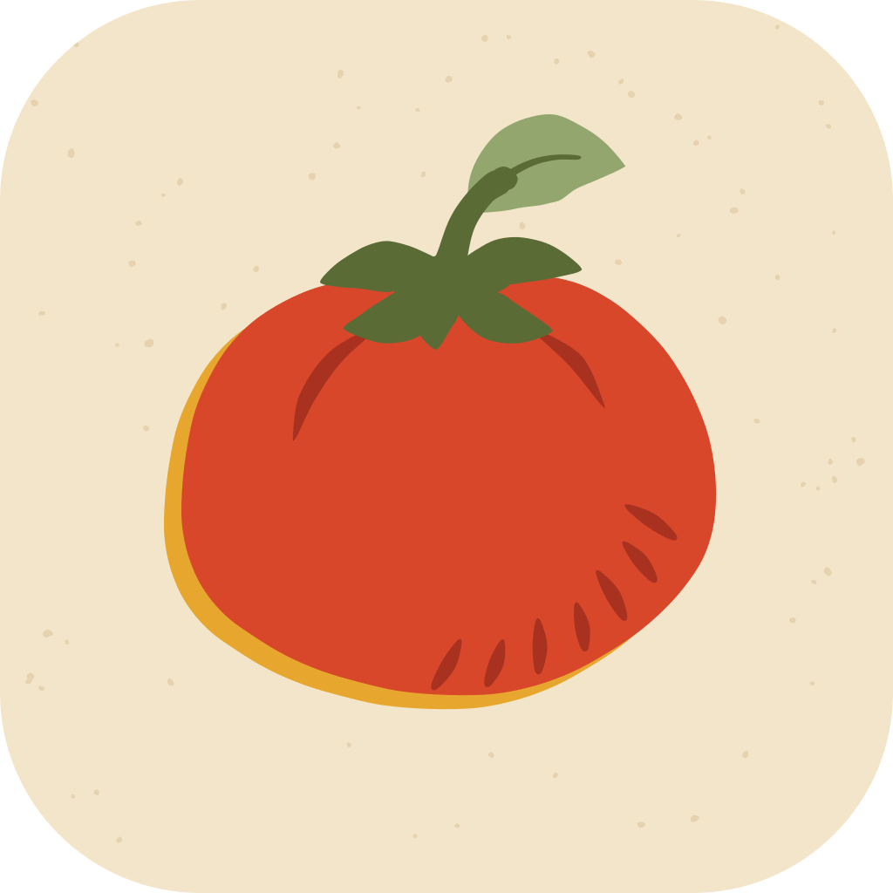
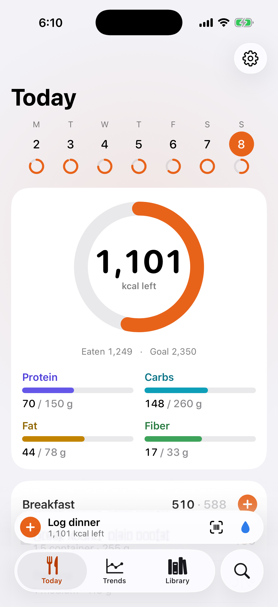
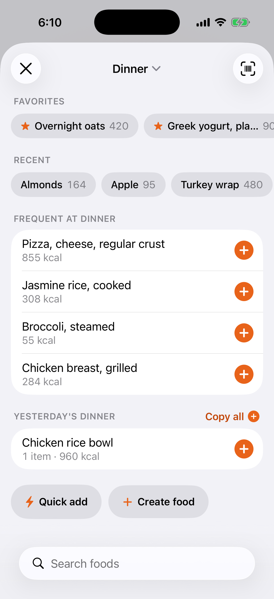
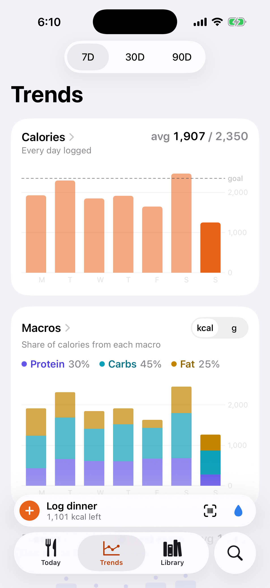
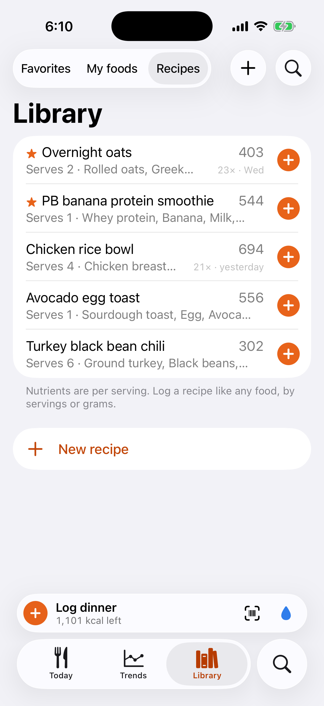

# Plate

**A self-hosted, private food tracker.** Plate is a native iPhone app (SwiftUI, iOS 26, Liquid
Glass) backed by a tiny Rust server you run yourself. Search, scan a barcode or tap a favorite to
log a meal, with full micronutrients from USDA FoodData Central and branded products from Open
Food Facts. Build recipes, and let your calorie and macro goals adapt to your weight and activity
from Apple Health. A `food` CLI on the server is built for AI agents and scripts, so anything that
can run a command (an agent reading a photo of your plate, say) can log for you, and it shows up
on your phone within a second. Your data stays on your machine, in an encrypted database.

<p align="center">
  
  
  
  
</p>

## How it fits together

```
  iPhone                                    Your server (Linux or macOS, your own user)
 ┌──────────────────────┐                  ┌─────────────────────────────────────────────┐
 │ Plate app            │      HTTPS       │ food serve                                  │
 │  offline cache       │  (Tailscale or   │  ├─ HTTP API on 127.0.0.1:18792             │
 │  outbox + long-poll  │◄────────────────►│  │    bearer token, live sync (long-poll)   │
 │  barcode scanner     │  reverse proxy)  │  ├─ encrypted SQLite (SQLCipher)            │
 │  Apple Health totals │                  │  ├─ USDA catalog, adaptive goals            │
 └──────────────────────┘                  │  └─ Unix socket ◄── food CLI ◄── you,       │
                                           │                                scripts,     │
                                           │                                AI agents    │
                                           └──────────────────────┬──────────────────────┘
                                                                  │ outbound only
                                                 Open Food Facts (barcodes, branded foods)
                                                 USDA FoodData Central (one-time download)
```

| Folder | What's in it |
|---|---|
| [`server/`](server/README.md) | `food`, one Rust binary: the service and its CLI. No root, no Docker, no external database. |
| [`app/`](app/README.md) | The SwiftUI iPhone app. No third-party packages. |
| [`docs/`](docs) | `SPEC.md` (data model, HTTP API, sync, CLI), `DESIGN.md` (the visual spec), `screens/` (screenshots) and `research/`. |

## Quick start

You need a machine that stays on (a home server, a VPS, a Mac mini), a Mac with Xcode 26 for the
app, and an iPhone on iOS 26.

### 1. The server

Install a Rust toolchain ([rustup.rs](https://rustup.rs)) and a C compiler, then:

```sh
cd server
cargo build --release
mkdir -p ~/.local/bin && cp target/release/food ~/.local/bin/   # put ~/.local/bin on your PATH

food init                  # config, data directory and database key; prints next steps
```

Run it as a user service. On Linux with systemd:

```sh
install -D -m 644 deploy/plate.service ~/.config/systemd/user/plate.service
systemctl --user daemon-reload && systemctl --user enable --now plate.service
loginctl enable-linger "$USER"     # keep it running while you're logged out
```

On macOS, `deploy/plate.plist` is a LaunchAgent with instructions inside. Then, with the service
running:

```sh
food seed-usda             # download and import the USDA catalog once (about 15 MB)
food token new             # the app token: keep it for step 3
food log --catalog "banana raw" --grams 118 && food today   # try it
```

`food init` takes `--timezone`, `--listen`, `--data-dir` and `--encryption keyfile|none`;
`food config` shows the effective settings. Everything is in [server/README.md](server/README.md).

### 2. Reach it from the phone

The server listens on loopback only and speaks plain HTTP; the phone needs HTTPS. Never expose
the port as plain HTTP on the internet.

- **Tailscale (recommended).** Install Tailscale on the server and the phone, then
  `tailscale serve --bg --https=8445 http://127.0.0.1:18792`. Your URL is
  `https://<machine>.<tailnet>.ts.net:8445`, reachable only from your tailnet.
- **A reverse proxy with TLS.** For a public hostname, put Caddy or nginx in front, for example a
  Caddyfile with `plate.example.com { reverse_proxy 127.0.0.1:18792 }`.

Check it with `curl https://<your URL>/v1/ping`.

### 3. The app

```sh
brew install xcodegen
cd app
xcodegen                   # writes Plate.xcodeproj (generated, gitignored)
open Plate.xcodeproj
```

Create `app/Local.xcconfig` (gitignored) with your own bundle id and Apple team:

```
PLATE_BUNDLE_ID = com.yourname.plate
PLATE_DEVELOPMENT_TEAM = ABCDE12345
```

Pick your iPhone as the destination and press Run. A free Apple account works too, without
HealthKit (add `PLATE_ENTITLEMENTS =` to `Local.xcconfig`).

On first launch Plate asks for your server's URL and the token. It checks both and tells you
what's wrong if either fails. Instead of typing, you can open, paste or scan a setup link:

```sh
qrencode -t ansiutf8 "plate://setup?url=https%3A%2F%2Fplate.example.com&token=YOUR_TOKEN"
```

More options, including script builds without an Xcode project, are in [app/README.md](app/README.md).

## Features

- **Fast logging.** One tap for favorites, recents and "the usual" for this meal; two for search.
  Barcode scanning, quick add (calories and macros only), copy yesterday's meal, and undo.
- **Real nutrition data.** About 13,600 USDA foods with up to 42 tracked nutrients (vitamins,
  minerals, fats, fiber, caffeine, water), scaled by grams or USDA portions. Open Food Facts fills
  in barcodes and branded foods.
- **Recipes.** Build them from any foods and log them by servings or grams; per-serving nutrition
  is computed on the server.
- **Adaptive goals.** Calories from your BMR (Mifflin-St Jeor) plus the active energy your Watch
  measured, with cut, maintain and bulk plans and per-nutrient overrides. Body data comes from
  Apple Health, a CSV or JSON import (`food health import`), or a few facts you type in
  (`food goals profile`). Nothing is guessed.
- **Trends and nutrients.** 7, 30 and 90-day charts for calories, macros, weight and
  micronutrients, and a daily view of every nutrient against its target.
- **Live sync, offline first.** The app works offline with an outbox; changes from the CLI appear
  on the phone within about a second.
- **Opt-out meal reminders** that only fire when nothing is logged for that meal yet.
- **Units** in metric or US, light and dark mode, and alternate app icons.

### A CLI built for agents and scripts

`food today`, `food log`, `food search`, `food report`, `food query` (read-only SQL) and the rest
print readable text or JSON (`--json`). `food --help` and `food <command> --help` are written to
be the complete documentation for an AI agent: they cover logging a meal from a photo, the
nutrient keys, batch logging and the gotchas. Point any AI coding agent or script at the CLI and
it can log, edit and report on your behalf.

```sh
food log --json < meal.json       # a whole meal at once
food goals plan cut
food report --days 7              # averages, adherence, weakest micronutrients
```

## Privacy and security

- **Your server, your data.** The app talks only to your server. The server makes outbound
  requests only to Open Food Facts (lookups) and USDA (the one-time catalog download).
- **Encrypted at rest.** The database is SQLCipher (AES-256). By default its key is a file next to
  it (mode 600), which protects copied backups and disk images. `--encryption none` is available
  for machines with full-disk encryption.
- **Hardened mode (optional).** [`server/deploy/hardened/`](server/deploy/hardened/README.md) runs
  the service as a dedicated system user with its key sealed to the machine's TPM via
  `systemd-creds`, in a locked-down systemd unit.
- **Access.** Every API route except `/v1/ping` needs the bearer token; tokens are stored as
  SHA-256 hashes and kept in the iOS Keychain on the phone. The CLI socket answers only the
  service's user, root and any users you list.

## Backups

```sh
food export ~/plate-backup.json   # everything that syncs, as JSON (mode 600)
food import ~/plate-backup.json   # restore; newer rows are kept
```

The export runs through the service, so it works with any encryption mode. The file itself isn't
encrypted: store it somewhere private, or encrypt it (for example with `age` or `gpg`). Keep a
copy of your key file too, or the database can't be opened.

## Development

```sh
(cd server && cargo test --release)
(cd app && ./ios-test.sh)         # lint, logic tests and a simulator self-test
```

Launching the app with `-PlateDemo YES` runs it on sample data, with nothing sent to a server.
`app/ios-build.sh` doubles as a recipe for the Gala build tool, an optional maintainer path;
Xcode with XcodeGen is the supported way to build the app.

## Data sources and attribution

- **USDA FoodData Central** (Foundation Foods, SR Legacy and FNDDS), U.S. Department of
  Agriculture, Agricultural Research Service, [fdc.nal.usda.gov](https://fdc.nal.usda.gov). Public
  domain (CC0 1.0).
- **Open Food Facts** ([openfoodfacts.org](https://world.openfoodfacts.org)). Data © Open Food Facts
  contributors, under the [Open Database License (ODbL) 1.0](https://opendatacommons.org/licenses/odbl/1-0/).
  Plate caches the products you look up; if you share data derived from it, keep the attribution
  and the ODbL terms.
- Daily values are the U.S. FDA's; adult RDAs are from the National Academies' Dietary Reference
  Intakes.

## License

License: not yet chosen. All rights reserved until a license is added.
